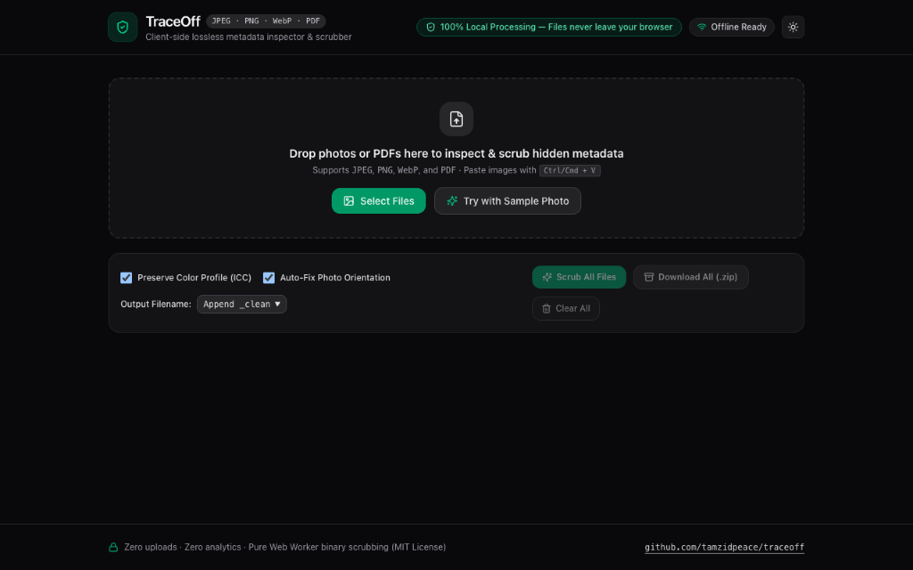
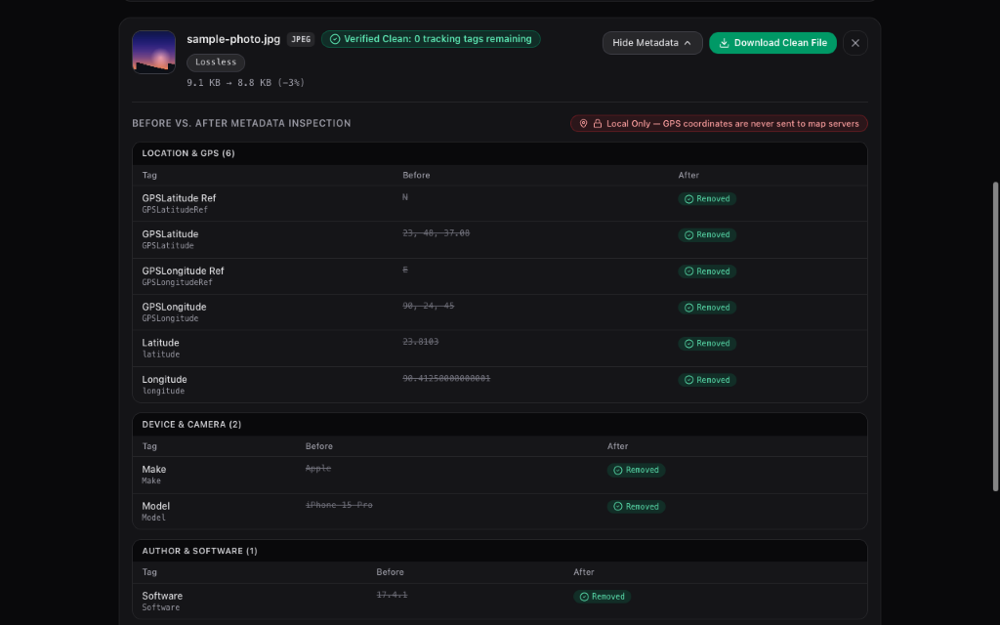

# TraceOff User Guide

TraceOff is a 100% client-side metadata inspector and scrubber for **JPEG**, **PNG**, **WebP**, and **PDF** files. Everything—inspection, scrubbing, post-scrub verification, and `.zip` packaging—runs inside a dedicated Web Worker in your browser. Your files are never uploaded anywhere.

- **Web App:** https://tamzidpeace.github.io/traceoff/
- **Source Code:** https://github.com/tamzidpeace/traceoff

---

## 1. Interface Overview

1. **Header Bar**
   - Displays the **100% Local Processing — Files never leave your browser** privacy badge.
   - Displays the live connectivity badge (**Offline Ready** when online, **Offline Mode** when disconnected).
   - Includes a dark/light theme toggle button in the top-right corner.
2. **File Dropzone**
   - Drag and drop files onto the dashed area, click **Select Files**, paste an image from your clipboard with `Ctrl/Cmd + V`, or click **Try with Sample Photo** to test immediately with a bundled sample JPEG.
3. **Options & Batch Actions Bar**
   - Configure scrubbing preferences (**Preserve Color Profile (ICC)**, **Auto-Fix Photo Orientation**, **Output Filename**) and run batch actions (**Scrub All Files**, **Download All (.zip)**, **Clear All**).

---

## 2. Adding & Inspecting Files

When you add one or more files, TraceOff validates each file's **magic bytes** (not just its filename extension) and immediately inspects it in a background Web Worker:

- **Supported formats:** `JPEG`, `PNG`, `WebP`, and `PDF`.
- **Automatic inspection:** Before scrubbing anything, each file card shows its format badge, file size, tracking tag count, category chips (such as `GPS`, `Camera/Device`, `Author/Software`, or `Embedded Images`), and a risk badge:
  - **High Risk (GPS + Device)** or **High Risk** (red): Location coordinates, unique device/camera identifiers, or embedded tracking fields were detected.
  - **Metadata Found** (amber): Non-critical metadata tags (such as software, timestamps, comments, or authoring fields) were detected.
  - **Already Clean** (green): Zero metadata tags were found.

Click **Inspect Metadata** on any file card to expand the **Discovered Metadata Inspector** drawer and view every detected tag grouped by category (`Location & GPS`, `Device & Camera`, `Author & Software`, `Timestamps`, `Embedded PDF Metadata`, and `Other / Raw Tags`).

> [!NOTE]
> When GPS metadata is found, TraceOff shows **Local Only — GPS coordinates are never sent to map servers**. Coordinates are displayed directly as text rather than loading external map tiles.

---

## 3. Configuring Scrubbing Options

Adjust options in the toolbar before scrubbing:

| Option | Default | What It Does |
| --- | --- | --- |
| **Preserve Color Profile (ICC)** | On | Keeps embedded ICC color profiles (such as sRGB or Display P3) intact during lossless JPEG/PNG/WebP scrubbing so colors stay accurate. Uncheck to strip ICC profiles as well. |
| **Auto-Fix Photo Orientation** | On | If a JPEG has EXIF orientation tags (`2`–`8`), TraceOff decodes and bakes the upright orientation into pixels via Canvas (`Oriented & Scrubbed (sRGB)`) so the photo does not appear sideways after stripping EXIF. |
| **Output Filename** | `Append _clean` | Choose between `Append _clean` (for example `photo_clean.jpg`) or `Keep original` (`photo.jpg`). |

### Lossless vs. `Oriented & Scrubbed (sRGB)`

- **Lossless:** Used for upright JPEGs, PNGs, WebPs, and JPEGs when **Auto-Fix Photo Orientation** is unchecked. Image pixel data is never re-encoded, and ICC color profiles are preserved when **Preserve Color Profile (ICC)** is enabled.
- **Oriented & Scrubbed (sRGB):** Used only when a JPEG has an EXIF orientation tag (`2`–`8`) *and* **Auto-Fix Photo Orientation** is enabled. Because HTML5 Canvas normalizes output to **sRGB**, wide-gamut ICC profiles (such as Display P3) are converted to sRGB and TraceOff displays a warning on the file card.
- If you turn **Auto-Fix Photo Orientation** off, rotated phone photos stay strictly lossless and ICC-preserved, and TraceOff displays a reminder that viewers without EXIF orientation support may show them rotated.

---

## 4. Scrubbing & Verifying Before vs. After

1. Click **Scrub** on an individual file card, or click **Scrub All Files** in the toolbar to process every queued ready file.
2. Once finished, TraceOff automatically re-inspects the scrubbed output bytes and updates the file card:
   - Shows **Verified Clean: 0 tracking tags remaining** (or a warning count if any unremovable fields remain).
   - Shows the processing mode badge (`Lossless`, `Oriented & Scrubbed (sRGB)`, `Deep PDF Scrubbed`, or `Already Clean`) and before/after byte size (for example `9.1 KB → 8.8 KB (-3%)`).
3. Click **Inspect Metadata** to open **Before vs. After Metadata Inspection** and confirm each tag's status (`Removed` in green, with original values struck through).
4. Click **Download Clean File** to save the scrubbed file.

---

## 5. Batch Scrubbing & ZIP Export

When working with multiple files:

- Click **Scrub All Files** to clean all `ready` files in sequence (excluding digitally signed PDFs that haven't been explicitly confirmed).
- Once **2 or more** files are scrubbed, **Download All (.zip)** becomes active. It bundles all cleaned files locally using `fflate` and automatically deduplicates colliding output filenames inside the archive.
- Click **Clear All** to clear the queue and release all in-memory object URLs.

---

## 6. Deep PDF Scrubbing & Special Cases

TraceOff inspects and scrubs PDFs beyond basic document properties (`Title`, `Author`, `Subject`, `Creator`, `Producer`, `CreationDate`, `ModDate`):

- **Document & XMP metadata:** Clears `Info` dictionary fields and catalog/page `/Metadata` streams plus `/PieceInfo`.
- **Annotations & popups:** Scrubs author/reviewer/timestamp fields (`/T`, `/Subj`, `/CreationDate`, `/M`) on page annotations and popup notes (while preserving interactive form widget field names `/T` on `/Subtype /Widget` annotations).
- **Form XObjects & embedded JPEGs:** Recursively inspects and strips `/Metadata` and `/PieceInfo` on `/Subtype /Form` XObjects, and scrubs embedded `/DCTDecode` JPEG image XObject streams using the lossless JPEG scrubber.

### Digitally Signed PDFs

If TraceOff detects cryptographic signature markers (`/ByteRange`, `/Sig`, `/DocMDP`), scrubbing is paused with a warning banner:

> *Digitally signed PDF — scrubbing alters bytes and invalidates cryptographic signatures.*

To scrub a signed PDF intentionally:
1. Check **I understand scrubbing will invalidate the digital signature**.
2. Click **Confirm & Scrub Signed PDF**.

### Encrypted / Password-Protected PDFs

Encrypted PDFs cannot be parsed or safely rewritten without decrypting them. TraceOff detects encryption and reports an error cleanly without modifying or uploading the file.

---

## 7. Installing & Using Offline (PWA)

TraceOff includes a service worker (`vite-plugin-pwa`) that caches the application shell for offline use:

1. Visit https://tamzidpeace.github.io/traceoff/ once in a modern browser (Chrome, Edge, Safari, or Firefox).
2. Optional: Click your browser's **Install App** / **Add to Home Screen** icon to install TraceOff as a standalone desktop or mobile app.
3. Disconnect from Wi-Fi or mobile data — the header badge switches to **Offline Mode** and all inspection, scrubbing, and `.zip` exports continue working normally.

---

## 8. Troubleshooting

- **"Unsupported format" error:** TraceOff verifies file headers via magic bytes. Ensure the file is a valid `.jpg`/`.jpeg`, `.png`, `.webp`, or `.pdf` and not a renamed `.heic`, `.avif`, or `.docx`.
- **Rotated output image:** Make sure **Auto-Fix Photo Orientation** is checked before scrubbing JPEGs taken on mobile phones.
- **No metadata found on an uploaded social-media image:** Platforms like WhatsApp, Instagram, and X already strip most EXIF tags; TraceOff will mark these as **Already Clean** with `0` tags.
